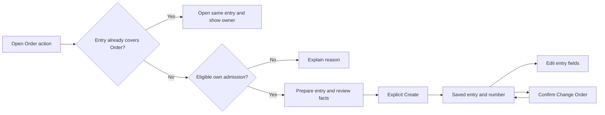

# Customs Storage Entry — expected flow

Mapped on 9 November 2026 before defect investigation. Source: Frontline-Forwarding/frontline-forwarding, named main `6aa259553cd9c86a8aaa157902088aa9a6bca83e`, verified through authenticated gh. This is a source baseline, not a verified deployed revision.

## Scope and requirements

Current full FRO-319 (entity), FRO-353 (Create), FRO-354 (Details) and FRO-355 (Order shortcut) are Done. FRO-358 is Backlog. Their historical Context-for-agents statements about absent entities or mock-only pages are not current implementation evidence. Current main has integrated customs-storage Create, Details, Order-card and service consumers.

Customs Storage Entry = Δελτίο Εισόδου, recording an Order's storage admission under Τελωνειακή Αποθήκευση. Order = purchase order = stock-list item; colli = physical handling unit. Customs Warehousing/Αποταμίευση and its ΑΛΚ are different. Established vocabulary already exists in CONTEXT.md.

This review owns Create/open, saved Details, entry-owned field edits, Change Order, admission/coverage, current derived values, entry access/validation/audit/recovery and entry guards on Orders. Export authoring, Customs transitions and VAT stamping stay excluded. Export and Supplier Invoice records are inputs to entry reads only; their own mutation flows remain with the existing reviews. FRO-358 list/menu, active-register screen/Excel/printing and recipient copies are excluded; absence of pending UI is not a bug. Backend active-case semantics may be checked as part of FRO-319; no FRO-358 implementation is proposed.

## Expected journey

| Stage | Expected outcome | Requirement / current implementation area |
| --- | --- | --- |
| Open from Order | Staff with view authority see the server-resolved card. Existing direct/inherited entry wins over ineligibility, including cancelled covered children. Loading/error are distinct from no entry; failed lookup offers Retry, never Create. No authority means no card/lookup. | FRO-355; order-card, hooks, entry reads/authorization |
| Check creation eligibility | Non-cancelled, Greece Yes/Customs Storage, own qualifying admission, no owned/inherited entry. Reasons ordered Cancelled → wrong regime → no admission → admitted under another Order → already covered. Missing invoices/Export/Supplier do not block. | FRO-319/353; coverage, admissions, reads |
| Admission and splits | Use first qualifying stock admission. Children split after admission, including further descendants and copied stock timestamps, share the admitted ancestor's entry. Pre-admission splits are independent. Family root/equal MRN alone do not establish coverage. | FRO-319/355; CustomsStorageAdmissions/Coverage |
| Select Order | Exact record ID, not parsed Stock ID. Preselection follows ordinary eligibility. Eligible selection loads derived facts and warehouse prefill; blocked/covered/missing/denied outcomes remain explicit. Search consumes server eligibility. | FRO-353; Create controller/mapping/service |
| Prepare entry | Entry time defaults to now in Athens. Ten entered/confirmed fields follow required date, future-date, tariff-text and length rules. Licence/operator/address prefill comes from the admitting warehouse and preserves manual edits under the agreed form rules. Tabs/language changes preserve the draft. | FRO-319/353; Create fields/rules |
| Read related facts | Admission fixes original colli count and admission-confirmed weight; missing any weight gives Unknown. Depositor is Invoice company, distinct from Client. Only owner's active storage Supplier Invoices count, even when opened from a covered child. | FRO-319/354; FactsReader/admission/mapping/cards |
| Read amounts and Export | Per-invoice Statistical VAT is hypothetical 24%, decimal half-up. Entry net/statistical totals require at least one matching invoice and all EUR; total VAT is rounded once. Current Export facts come through matching invoices, without family aggregation or entry-owned copies. | FRO-319; InvoiceTotals/FactsReader; related cards |
| Create | Explicit submit only; server authorizes, normalizes, locks/rechecks eligibility, allocates a unique continuous number and writes entry/audit in one transaction. Refusal/rollback consumes nothing. Concurrent existing entry is offered, never overwritten or claimed as this user's success. | FRO-319/353; CreationService/repository/schema |
| Recover creation | On an uncertain response retain original draft/context, check by original Order, distinguish saved/existing/unresolved/not-created outcomes and avoid an uncontrolled second submission. Successful saved-record navigation failure must preserve the saved identity. | FRO-353 actions/outcomes; Create controller/service |
| Read saved entry | Route uses entry number; actions use saved identity. Preserve origin Order return context; inherited access identifies actual owner. View-only staff cannot edit. Denied, missing and failed reads are separate states. | FRO-354/355; Details host/layout/read API |
| Edit fields | One card at a time; send only intended changes against the version actually reviewed. Omission preserves, null/blank clears optional values. Stale/refused/uncertain outcomes retain work; Cancel restores saved state. Tab/language changes do not discard it. | FRO-319/354; Details controller/mapping/EditingService |
| Change Order | Explicit confirmed target must pass current server eligibility and cannot be current owner or covered by this entry. Keep number and all entry-owned values; derive admission/parties/invoices/Export from new owner. Explain a different warehouse and review saved warehouse text. Refresh old/new owner and covered lookups; do not mutate Orders/invoices/Export. | FRO-319/354; Change Order dialog/service/coverage |
| Active case | Active unless at least one matching invoice exists and all are in one Export with MRN. A later unassigned matching invoice makes it active again. Physical goods departure, Customs status, IE599 and invoice exemption do not define this rule. No stored entry status/lifecycle. | FRO-319; CustomsStorageRegister active-case calculation; UI outputs excluded |
| Protection and history | Owner/covered Orders cannot leave Customs Storage/Greece Yes. Owner cannot be cancelled by terminating its last movable colli; covered child can. Authorized changes append actor/time/before-after audit; failures and unchanged saves write nothing. No entry cancel/delete/reissue. | FRO-319; OrderGuard, services, repository/schema |

## Consumer ownership and preservation

| Consumer | Current source | Expected outcome | Review ownership |
| --- | --- | --- | --- |
| Create, Details and Order shortcut | Client features/customs-storage and secured routes | Correct identity, authority, editable state, recovery and return context | This review |
| Admission, coverage and numbers | App domain/customsstorage, schema and admission/split callers | One entry per actual admission owner; stable original admitted facts | This review |
| Entry fields/audit and read API | CreationService, EditingService, Reads, repository, web/customsstorage | Validation, reviewed version, atomic persistence and staff-only output | This review |
| Order guards | CustomsStorageEntryOrderGuard and existing Order callers | Preserve established regime/cancellation restrictions | Boundary here; other Order/Shipment bugs retain their owner |
| Invoice and Export consumers | FactsReader, InvoiceTotals, related tabs | Owner-only facts, correct rounding/currency/coverage, no source mutations | Entry read behavior here; source workflows excluded |
| Active register data | FRO-319 calculation | Correct active rule and one owner row | Backend boundary only; FRO-358 presentation excluded |

## Verification boundary

Source/code review and isolated synthetic tests are authorized. No live portal/database writes, outbound email, AADE, production branch or implementation change. Current deployed version, real authorization sessions, full browser journeys, SQL locking/rollback and production concurrency remain unverified unless separately demonstrated and recorded.

Expected scenario coverage is in [the scenario register](../scenarios/customs-storage-entry.md). Findings and executed evidence will be recorded separately; mapping a scenario does not mark it passed. Existing UI contracts suffice; canvas/preview/UI branch are skipped. No new vocabulary or ADR is required by this mapping.

## Initial review completed

[9 November review](../runs/2026-11-09-customs-storage-entry.md) records ten isolated UI findings, 115 existing frontend checks, 27 new UI observations/controls and 155 backend controls. Parent independently reran retained evidence. All complete portal scenarios remain Not run; source inspection and extracted backend checks do not establish database concurrency/rollback or deployed correctness. No Linear creation or source fix occurred.
