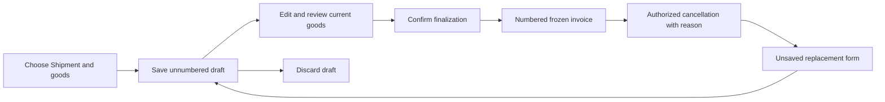

# Shipment Invoice — expected flow

Mapped on 9 November 2026 **before defect investigation**. Source baseline: `Frontline-Forwarding/frontline-forwarding`, main `6aa259553cd9c86a8aaa157902088aa9a6bca83e`, freshly verified through authenticated gh. Deployed version is not established.

## Scope and requirements

Current full FRO-244 (entity), FRO-363 (Create), FRO-366 (Details) and FRO-301 (allocation) are Done; FRO-371 (global list/menu) is Backlog. FRO-244/363/366 comments were fetched and empty. Historical descriptions of unmounted mocks or copied rows are not proof of current behavior: current main contains integrated routes/services and allocation. No new business decisions are inferred from code.

Shipment Invoice declares selected goods accompanying one Shipment; it is distinct from Supplier Invoice, Front Line client billing, Delivery Note and Export. Order = purchase order = stock-list item; colli = physical handling unit.

This review owns Shipment Invoice creation, goods consumption, live drafts, review acknowledgement, finalization/numbering, frozen contents, discard, cancellation, replacement and its Shipment guards. Export/Customs/VAT paperwork stays in the other chat. Allocation is checked as an input/boundary; no new general Order/Shipment audit. PDF/print controls and discounts are explicitly future work in FRO-244, and global list/menu belongs to FRO-371: their absence is not a new bug.

## Normal journey and branches

| Stage | Expected behavior | Current source / requirement |
| --- | --- | --- |
| Open | Authorized staff use Shipment Details → Shipment invoices → Create invoice, or the standalone creation route. Non-cancelled Shipments, including departed/arrived, are eligible. | Shipment invoices card; secured shipment-invoices routes; FRO-244/363 |
| Choose parties | Auto-select the sole represented Client; choose among represented Clients otherwise. Invoice company belongs to that Client and prefills editable Shipper. Goods are not filtered by that company. | Goods reader, rules, create form; FRO-244/363 |
| Choose goods | Start with no selections. Selecting an Order adds its eligible rows in source order, newest Order group first. Whole-row allocation determines eligibility; awaiting allocation rows remain disabled with a reason and an Order link. | Goods reader, evaluations, selection helpers; FRO-301/363 |
| Prepare | Invoice/today in Athens/PACKING LIST defaults; manual packing/weight and optional partial value. Full amount comes from selected rows in one currency; mixed selections remain visible but block save. Same-Shipment overlap warns and is allowed. | Invoice fields/rules; create components; FRO-244/363 |
| Refresh / leave | Refresh preserves entered document facts and eligible selections, updates amounts and visibly identifies unavailable selections. New rows remain unselected. Protect Shipper/Shipment changes and dirty navigation. Read failure is not an empty valid result. | Create/Details host adapters and guards; FRO-363/366 |
| Create draft | Only Shipment is required for an otherwise valid incomplete draft. Actor/payload-bound request ID supports replay. No printed number; success opens returned Details identity. Uncertain result retains original attempt. | ShipmentInvoiceService, repository, Create host; FRO-244/363 |
| Edit saved draft | Shipment stays locked. Preserve saved facts/selection/order, allow incomplete valid saves and refresh live source values. Carry the version actually reviewed; stale/unknown outcomes preserve work. | Details editor/actions and service; FRO-366 |
| Review | Confirm the selected source values/eligibility and checked packing/weight/partial amount. Backend fingerprint binds acknowledgement to the reviewed state; changes invalidate it. Deleted/unavailable rows require resolution. | ShipmentInvoiceEvaluations/Rules/Service; FRO-244/366 |
| Finalize | Validate required Client/company/type/date/Shipper/Consignee/Agent/packing/weight and eligible single-currency rows. Confirm reviewed document, lock/recheck, freeze fields and line identities/values, allocate one continuous number atomically. Refusal/rollback consumes no number. | Service/repository, ADR 0014; FRO-244/366 |
| Frozen record | Finalized and cancelled invoices display frozen base contents; later source-row/company changes cannot rewrite them. Retain source identities/history even after row deletion. | Repository frozen lines/view; FRO-244/366 |
| Discard | Explicitly discard an unnumbered draft; retain it for replay/history, omit from Shipment card. Successful navigation returns to Shipment. Cancel editing is separate. | Service/Details; FRO-244/366 |
| Cancel | Authorized manager/system administrator cancels a finalized invoice with reason; retain number/frozen contents. Cancellation does not automatically create replacement. | Authorization/service/Details; FRO-244/366 |
| Replace | Read unsaved prefill from cancelled original, same locked Shipment, today's Athens date. Copy document/packing/partial fields but select only currently eligible original rows using current values; flag cleared references/missing rows. Save explicitly, link both ways, start unreviewed/unnumbered. One live replacement; discarded replacement frees slot. | Replacement prefill/service/Details host; FRO-244/366 |
| Shipment boundary | Draft/finalized invoices block Shipment cancellation. Membership removal must preserve finalized-document accuracy through the agreed confirmation rule; allocation corrections identify affected invoices. | ShipmentInvoiceGuard and callers; FRO-244/301 |

## Consumer ownership

| Consumer | Required outcome / audit owner |
| --- | --- |
| Create UI, host, mapping and services | Current selection/facts/request identity survive refresh, failure and navigation; creation subagent |
| Details editor, lifecycle dialogs, replacement host | Reviewed version and action identity preserved; frozen states/recovery/navigation correct; Details subagent |
| Service, rules, evaluation, authorization, repository | Eligibility, review, guards, frozen data and numbering enforced; backend subagent plus parent source trace |
| REST and GraphQL adapters, card and cross-entity readers | Same authorized service; accurate return identity/status/links; parent |
| Export, Customs, VAT and existing bug tickets | Outside scope; existing findings not silently expanded |

## Evidence plan and limits

Run existing focused frontend tests, add isolated observations/controls on actual integrated components, and execute actual backend rule/method bodies where the installed runtime permits. Parent independently re-runs retained evidence. Never equate source inspection or mocks with real PostgreSQL, transaction, network or deployed-browser execution. All scenarios start Not run until evidence is recorded in the run report.

No production source, portal, database, AADE or email writes. Current instructions, source workflow `docs/workflows/shipment-invoice.md`, generated database/API references and ADRs 0003/0006/0013/0014 guide the review. Policy loader failed on the archive's missing Git metadata; direct instructions/policies read, no successful loader fingerprint claimed. Existing presentation reused: no canvas/preview or production branch. No Linear creation/edit until findings are discussed and drafts approved separately.

The [completed initial review](../runs/2026-11-09-shipment-invoice.md) records eight isolated findings, passing controls, parent reruns and unexecuted end-to-end boundaries. Expected behavior above remains the requirements baseline, not a claim that every stage currently passes.

The eight findings are assigned to [created correction tickets FRO-386 and FRO-387](../../../drafts/shipment-invoice-bugs/README.md): creation/replacement/recovery and goods/totals/review/frozen history. Existing requirement tickets remain references only. Creation was verified; implementation and deployed fixes remain unverified.
